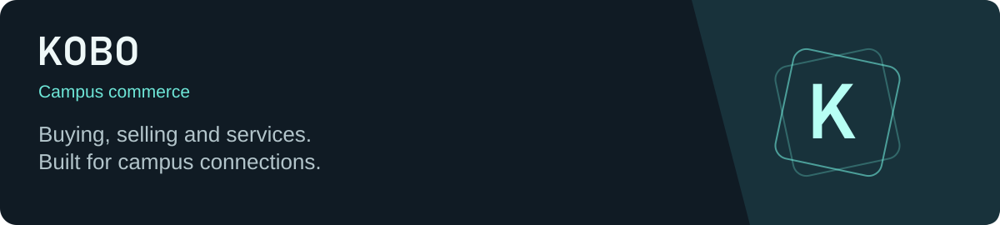
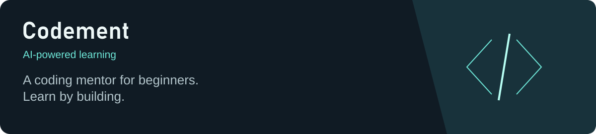
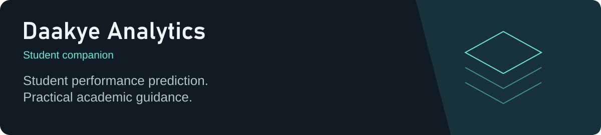

  <picture>
    <source media="(max-width: 600px)" srcset="./assets/profile-hero-mobile.svg" />
    
  </picture>

  <a href="#selected-work">Selected work</a> &nbsp; / &nbsp;
  <a href="#toolkit">Toolkit</a> &nbsp; / &nbsp;
  <a href="#lets-connect">Let's connect</a>

 

## Ideas into things people can use.

I'm **Godfreds PRIMEEE**, a Computer Science student growing as a full-stack developer. I build web, mobile, and AI-powered products that help people learn, connect, and get things done.

I enjoy the whole process: the first sketch, the interface, the API, and the release.

 

## Selected work

<a href="https://github.com/GodfredsPrim/kobo-downloads">
  <picture>
    <source media="(max-width: 600px)" srcset="./assets/project-kobo-mobile.svg" />
    
  </picture>
</a>

[Explore KOBO downloads](https://github.com/GodfredsPrim/kobo-downloads)

 

<a href="https://github.com/GodfredsPrim/codement">
  <picture>
    <source media="(max-width: 600px)" srcset="./assets/project-codement-mobile.svg" />
    
  </picture>
</a>

[Explore Codement](https://github.com/GodfredsPrim/codement)

 

<a href="https://github.com/GodfredsPrim/Daakye-Analytics-Student-Companion">
  <picture>
    <source media="(max-width: 600px)" srcset="./assets/project-daakye-mobile.svg" />
    
  </picture>
</a>

[Explore Daakye Analytics](https://github.com/GodfredsPrim/Daakye-Analytics-Student-Companion)

 

**Also building for everyday problems:** [Ghana Power Outage Portal](https://github.com/GodfredsPrim/ghana-power-outage-portal), a way to report and track electricity outages.

 

## Toolkit

  

| Web & mobile | Data & backend | Design & workflow |
| :--- | :--- | :--- |
| JavaScript / TypeScript | Python | Figma |
| React / Expo | PostgreSQL / MongoDB | Git / GitHub |
| Node.js | APIs | Product design |

 

## Beyond the code

I also create content through **GTech Vlogs**. I'm always learning how to take a practical idea further, from design and development to getting it into people's hands.

 

## Let's connect

**Have a useful problem worth solving? Let's build something.**

Open to collaborations and learning opportunities.

  
  
  

